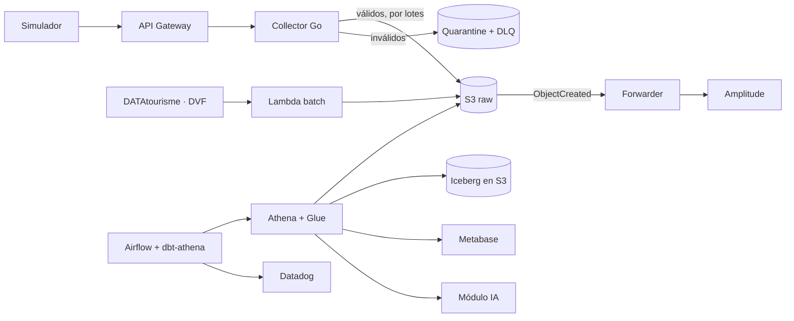

# trueflow

Plataforma de datos end-to-end para un **marketplace de anuncios basado en la confianza**: los miembros entran
por padrinazgo y publican anuncios de alquiler de temporada, inmobiliario y servicios en **Nantes y
Loire-Atlantique (44)**.

> Proyecto portfolio de Data Engineering. Cada decisión técnica se explica, se mide y se documenta.
> **Estado:** arranque del repo (M0), arquitectura aprobada ([ADR 0001](docs/adr/0001-lakehouse-on-free-plan.md)). Todavía no hay código ni infraestructura desplegada.
> Proyecto educativo: vive unas semanas en una cuenta AWS en Free plan y se desmantela al terminar.

## Qué resuelve

Dar a Producto, Marketing y Product Ops un acceso a los datos **estable, seguro y observable**: desde el tracking
de eventos hasta los dashboards y las funcionalidades con IA.

## Arquitectura



- Diagrama completo: [docs/architecture/architecture.md](docs/architecture/architecture.md)
- Flujo de datos (linaje, secuencias, RGPD): [docs/architecture/data-flow.md](docs/architecture/data-flow.md)

## Fuentes de datos

| Fuente | Uso |
|---|---|
| [DATAtourisme](https://www.datatourisme.fr/) (Licence Ouverte 2.0) | Catálogo de alojamientos en el 44, ingesta diaria, historizado SCD2 |
| [DVF / geo-DVF](https://www.data.gouv.fr/) | Transacciones inmobiliarias, precio/m² por barrio |
| Inside Airbnb Bordeaux (opcional) | Texto de reseñas para el módulo de IA |
| Simulador (`simulator/`) | Eventos de producto sintéticos anclados en IDs reales |

No se hace scraping de ninguna plataforma.

## Stack

AWS (eu-west-3, Free plan): API Gateway, Lambda, S3, SQS, EventBridge, Athena, Glue Data Catalog, Iceberg,
Secrets Manager, Budgets, Bedrock · Terraform · Go · Python 3.12 + uv · dbt-athena · Airflow 3.x · Metabase ·
Datadog · Amplitude · GitHub Actions (OIDC).

## Principios

- **Lakehouse**: raw inmutable en S3 y transformaciones con dbt sobre Athena en tablas Iceberg (staging → intermediate → marts).
- **Coste acotado**: solo servicios del Free plan y presupuesto de 25 USD/mes con alertas.
- **At-least-once** con deduplicación por `event_id`; eventos tardíos con ventana de lookback.
- **RGPD por diseño**: seudonimización HMAC en el collector, minimización, retención y derecho de supresión auditado.
- **SLOs medidos**: disponibilidad, tasa de error, latencia p50/p95, freshness y coste en `mart_pipeline_slo` y Datadog.

## Roadmap

| Hito | Contenido |
|---|---|
| M0 | Tooling, pre-commit, CI, backend Terraform, alarma de presupuesto |
| M1 | Ingesta batch DATAtourisme + DVF → S3 raw → Athena → staging dbt |
| M2 | Tracking plan + collector Go → S3 raw, DLQ/quarantine |
| M3 | DAGs Airflow, compactación Iceberg, calidad de datos, marts |
| M4 | Dashboards Metabase + forwarder Amplitude |
| M5 | Observabilidad: Datadog como código, runbooks |
| M6 | RGPD: DAG de supresión, retención |
| M7 | Módulo IA con evaluación offline |
| Cierre | Desmantelamiento de todos los recursos de AWS |

## Comandos (previstos)

Aún no existe el `Makefile`; estos son los comandos planificados:

```
make setup | data-download | test | lint | up | down | tf-plan ENV=dev | simulate RATE=50 | dbt-build | destroy ENV=dev
```

## Cómo se trabaja

Flujo **RePPIT** (Research → Propose → Plan → Implement → Test) con validación humana en cada fase; los
documentos de diseño viven en [`docs/design/`](docs/design/README.md). Instrucciones para agentes en
[`CLAUDE.md`](CLAUDE.md).
