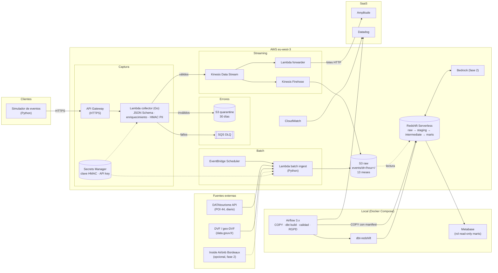

# Arquitectura — trueflow

Vista de componentes y límites de AWS (región **eu-west-3**). Fuente: `CLAUDE.md` §3. Estado: **propuesta**, nada desplegado.

## Decisiones clave (resumen; detalle futuro en `docs/adr/`)

| Decisión | Motivo |
|---|---|
| eu-west-3 (París) | Residencia de datos RGPD |
| Collector en Go | Cold start bajo, validación tipada |
| ELT con raw inmutable | Re-procesable; transformaciones versionadas en dbt |
| At-least-once + dedupe por `event_id` | Kinesis/Firehose pueden duplicar |
| Airflow local (no MWAA) | Coste |
| SCD2 en `dim_listing` | DATAtourisme cambia a diario |
