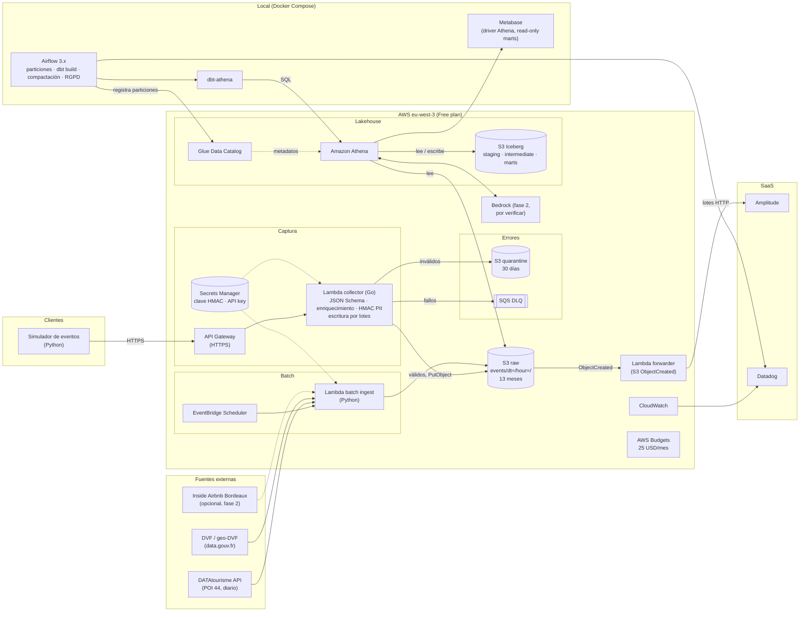

# Arquitectura — trueflow

Lakehouse en S3 sin streaming, región **eu-west-3**, solo servicios del Free plan (ADR [0001](../adr/0001-lakehouse-on-free-plan.md)).
Fuente: `CLAUDE.md` §3. Estado: **propuesta aprobada**, nada desplegado.

## Decisiones clave (detalle en `docs/adr/`)

| Decisión | Motivo |
|---|---|
| eu-west-3 (París) | Residencia de datos RGPD |
| Sin Kinesis, Firehose ni Redshift | No disponibles en el Free plan (ADR 0001) |
| Collector en Go, escritura directa a S3 por lotes | Cold start bajo; agrupar reduce objetos pequeños |
| Athena + Glue + Iceberg con dbt-athena | Pago por consulta; `DELETE`/`MERGE` por fila para RGPD |
| ELT con raw inmutable | Re-procesable; transformaciones versionadas en dbt |
| At-least-once + dedupe por `event_id` | Reintentos de Lambda y del cliente pueden duplicar |
| Airflow local (no MWAA) | Coste |
| SCD2 en `dim_listing` | DATAtourisme cambia a diario |
