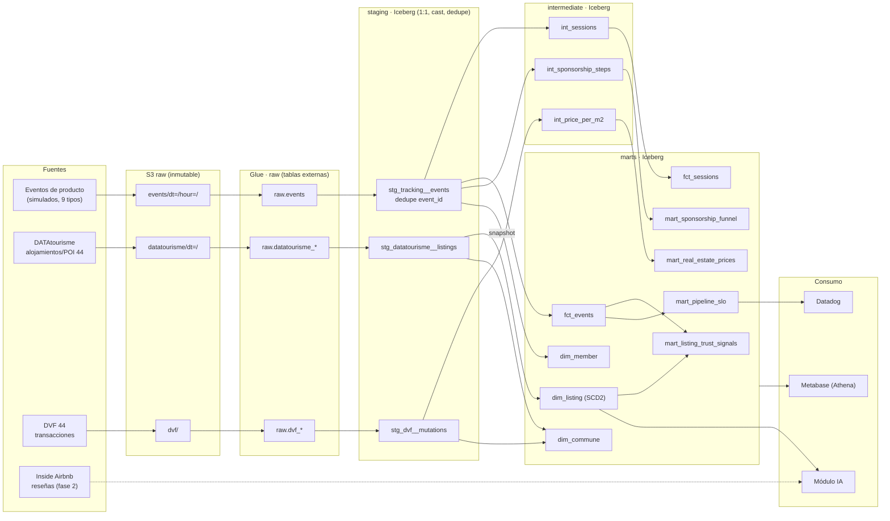
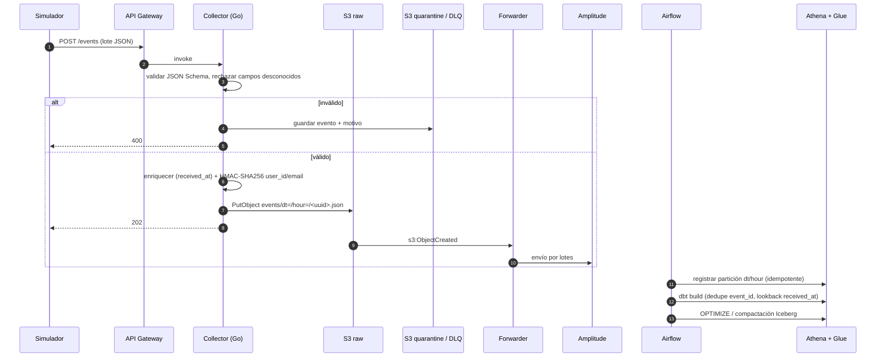
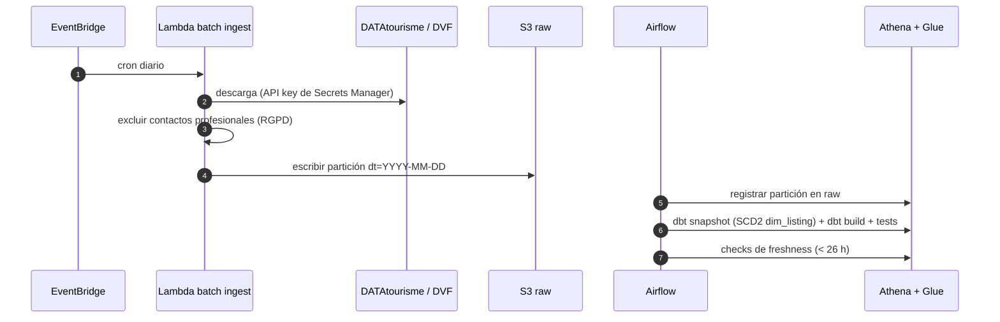

# Flujo de datos — trueflow

Recorrido del dato desde la fuente hasta el consumo. Fuente: `CLAUDE.md` §2, §3, §5, §9; ADR [0001](../adr/0001-lakehouse-on-free-plan.md).
Estado: **propuesta aprobada**. Los nombres de modelos intermedios son orientativos hasta las propuestas de M1–M3.

## 1. Linaje por capas

## 2. Secuencia de un evento

## 3. Camino batch (diario)

## 4. Controles RGPD en el flujo

| Punto | Control |
|---|---|
| Collector | HMAC-SHA256 de `user_id`/email/nombre; rechazo de campos fuera del tracking plan |
| Batch ingest | Exclusión de teléfonos/emails de profesionales; `host_name`/`reviewer_name` eliminados |
| S3 | Lifecycle: raw 13 meses, quarantine 30 días |
| Iceberg | DAG de supresión: `DELETE` vía Athena sobre `gdpr_erasure_requests` + expiración de snapshots; reescritura de objetos raw; auditado |
| Consumo | Metabase solo lectura sobre la base `marts`; texto a LLM sin PII |
