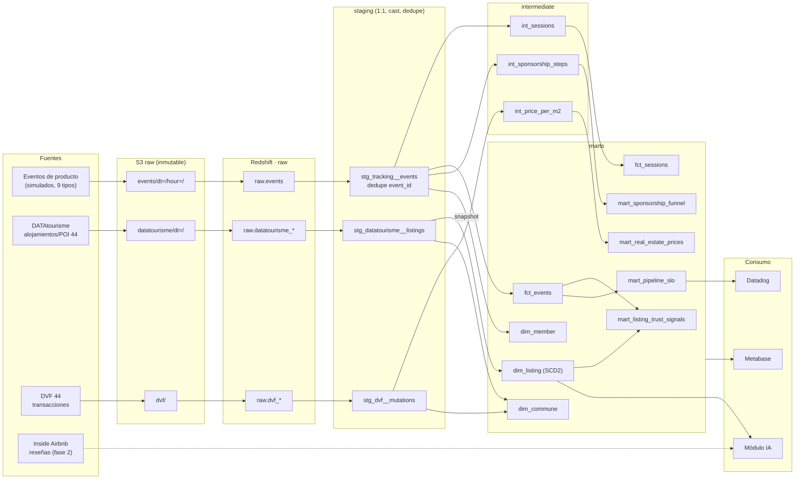
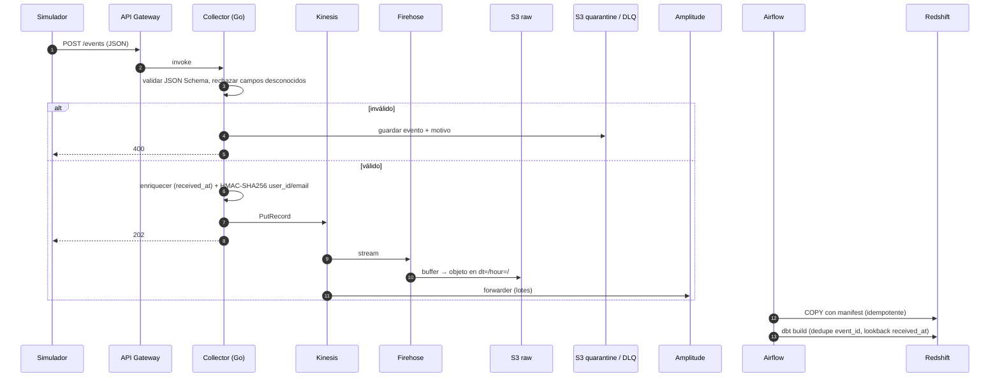
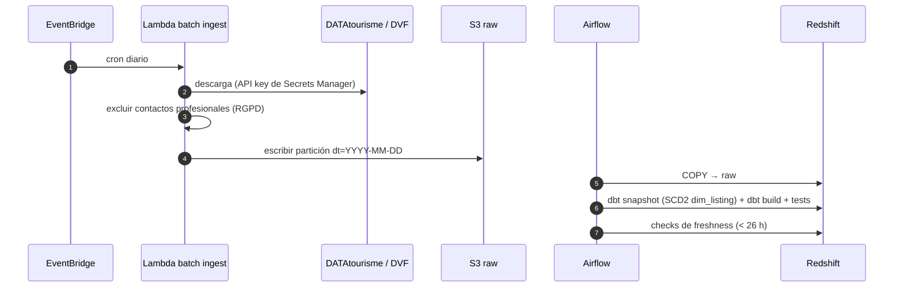

# Flujo de datos — trueflow

Recorrido del dato desde la fuente hasta el consumo. Fuente: `CLAUDE.md` §2, §3, §5, §8. Estado: **propuesta**.

## 1. Linaje por capas

## 2. Secuencia de un evento (camino caliente)

## 3. Camino batch (diario)

## 4. Controles RGPD en el flujo

| Punto | Control |
|---|---|
| Collector | HMAC-SHA256 de `user_id`/email/nombre; rechazo de campos fuera del tracking plan |
| Batch ingest | Exclusión de teléfonos/emails de profesionales; `host_name`/`reviewer_name` eliminados |
| S3 | Lifecycle: raw 13 meses, quarantine 30 días |
| Redshift | DAG de supresión sobre `gdpr_erasure_requests`, auditado; reescritura de particiones S3 |
| Consumo | Metabase solo lectura sobre `marts`; texto a LLM sin PII |
