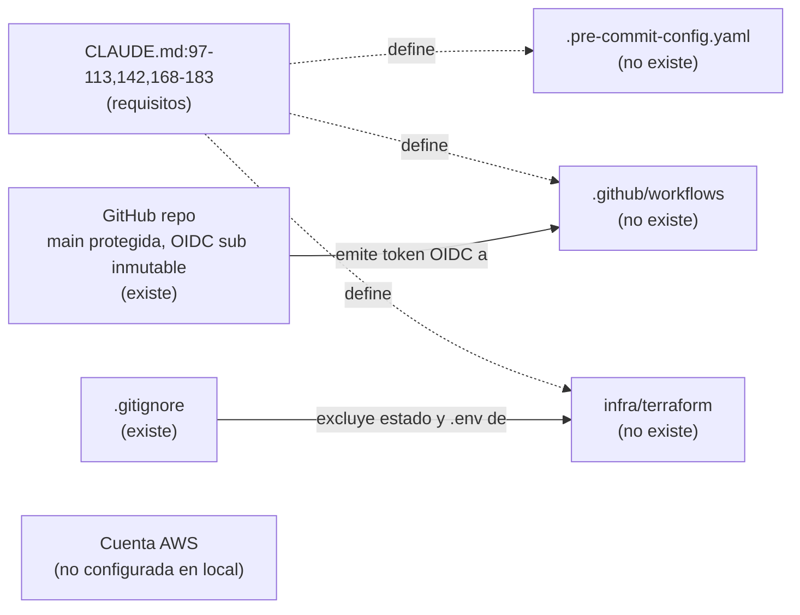

# RESEARCH — Mapeo de arquitectura y datos

Modo read-only: solo se documenta lo que existe hoy. Este fichero es el único artefacto creado.

## 1. Estado actual del repositorio

```
$ find . -type f -not -path '*/.git/*' | grep -v DS_Store
./CLAUDE.md
./skills/{reppit-research,reppit-propose,reppit-plan,reppit-implement,reppit-test,
          adversarial-review,grill-me,design-memory}/...   (SKILL.md + plantillas/scripts)

$ git status
fatal: no es un repositorio git (ni ninguno de los directorios superiores): .git

$ ls -la .claude ; ls docs
ls: .claude: No such file or directory
ls: docs: No such file or directory

$ python3 skills/design-memory/scripts/design_check.py docs/design
usage error: docs/design/CONTEXT.md not found

$ wc -l CLAUDE.md
223 CLAUDE.md
```

**Hallazgo:** el proyecto es solo una propuesta. No existe ninguno de los directorios de §4 de CLAUDE.md
(`collector/`, `dbt/`, `infra/terraform/`, `tracking-plan/`, `airflow/`, `Makefile`, etc.). No hay
repositorio git, ni `.claude/`, ni `docs/design/`.

## 2. Tooling local disponible

```
python3: Python 3.9.6          (CLAUDE.md §5 exige 3.12 → lo gestionaría uv)
uv:      0.13.5
go:      not found             (requerido por collector/ y forwarder/)
terraform: not found           (requerido por infra/ y observability/)
aws:     not found
dbt:     dbt-core 1.10.23 (instalado vía uv tool sobre Python 3.9; sin adapter redshift listado)
docker:  29.8.2                (Airflow + Metabase local)
make:    GNU Make 3.81
```

## 3. Arquitectura propuesta (CLAUDE.md §3)

| Capa | Componentes | Lenguaje / servicio |
|---|---|---|
| Captura de eventos | API Gateway → Lambda collector (validación JSON Schema, enriquecimiento, HMAC de PII) | Go |
| Streaming | Kinesis Data Stream → Firehose → S3 raw `events/dt=/hour=/` | AWS gestionado |
| Errores | S3 quarantine (30 d) + SQS DLQ | AWS |
| Reenvío | Lambda forwarder Kinesis → Amplitude HTTP API (lotes) | — |
| Batch | EventBridge Scheduler → Lambda ingest (DATAtourisme diario, DVF) → S3 raw | Python |
| Orquestación | Airflow 3.x local (Docker): COPY → `raw`, dbt build, calidad, borrado RGPD | Python |
| Warehouse | Redshift Serverless eu-west-3; dbt staging → intermediate → marts | SQL/dbt |
| Consumo | Metabase (rol read-only sobre `marts`), Datadog, módulo IA (Bedrock) | — |

### Flujo de datos

1. **Eventos (tiempo casi real):** simulador → collector → válidos a Kinesis (fan-out a Firehose/S3 y a
   Amplitude), inválidos a quarantine/DLQ. Entrega at-least-once → dedupe por `event_id` en staging.
2. **Batch (diario):** DATAtourisme (alojamientos/POI 44) y DVF (transacciones 44) → S3 raw.
3. **ELT:** Airflow ejecuta COPY idempotente con manifest a `raw`, después `dbt build`.
   Eventos tardíos: incrementales con lookback sobre `received_at`. `dim_listing` en SCD2 (snapshot).
4. **Consumo:** marts (`fct_events`, `fct_sessions`, `dim_listing`, `dim_member`, `dim_commune`,
   `mart_sponsorship_funnel`, `mart_listing_trust_signals`, `mart_real_estate_prices`, `mart_pipeline_slo`).

## 4. Caso de uso y datos

- Marketplace por padrinazgo; verticales: alquiler de temporada, inmobiliario, servicios; ámbito Nantes / 44.
- Fuentes reales: DATAtourisme (Licence Ouverte 2.0, API con clave), DVF/geo-DVF (ficheros por dpto.),
  Inside Airbnb Bordeaux (opcional, solo texto de reseñas, fase 2). Eventos de producto: sintéticos
  anclados en IDs reales.
- 9 eventos del tracking plan: `signup_started`, `sponsorship_requested`, `sponsorship_accepted`,
  `member_validated`, `listing_viewed`, `listing_published`, `contact_requested`, `booking_requested`,
  `review_posted`. Aún no existe `tracking-plan/`.
- RGPD (§8): HMAC-SHA256 en collector, exclusión de contactos profesionales DATAtourisme, rechazo de
  campos desconocidos, retención S3 13 meses / 30 días, DAG de supresión auditado.
- NFR (§7): disponibilidad ≥ 99,5 %, DLQ > 0 durante 15 min, p50/p95 latencia, freshness DATAtourisme < 26 h,
  AWS Budgets.

## 5. Inconsistencias observadas en CLAUDE.md

Se documentan tal como están; no se proponen cambios.

```
$ grep -n "reppit-" CLAUDE.md
131: Skills en `.claude/skills/` ...: `reppit-research`, `reppit-spec`, `reppit-plan`,
132: `reppit-implement`, `reppit-verify`, ...
206: 1. `reppit-research` → `current/research.md` (aquí, carpeta `current/research/`)
207: 2. `reppit-propose` → `working/proposal.md`
210: 5. `reppit-test` → `working/test.md`
```

1. **Dos flujos de trabajo:** §6 usa `specs/<NNN>/{research,spec,plan,impl-log,verify}.md`; la sección
   "Flujo de trabajo" usa `docs/design/<topic>/working/`. Esta última dice prevalecer.
2. **Nombres de skills:** §6 cita `reppit-spec`/`reppit-verify`; en `skills/` existen `reppit-propose`/`reppit-test`.
   Las skills de dominio (`dbt-model`, `terraform-module`, `go-lambda`, `airflow-dag`, `interview-notes`) no existen.
3. **Ruta de research:** línea 206 dice `current/research.md`; el SKILL.md dice `working/research.md`.
4. **`.claude/skills → ../skills`:** el symlink no existe; tampoco `.claude/settings.json` (hook Stop citado).
5. **Git:** CLAUDE.md asume ramas `feat/<NNN>` y `main`, pero el directorio no es un repo git.
6. **Este fichero** (`docs/RESEARCH.md`) se pidió fuera de la convención `docs/design/` .

## 6. Preguntas abiertas

- ~~¿Qué convención de rutas manda?~~ Resuelto 2026-11-05: manda `docs/design/`. Git inicializado (`main`) y symlink `.claude/skills → ../skills` creado.
- ¿Se instalan Go, Terraform y AWS CLI localmente o solo en CI?
- ¿Python 3.12 vía `uv python install`? ¿dbt-redshift en el proyecto (no como tool global sobre 3.9)?
- ¿Acceso a la API de DATAtourisme (clave) o exports de data.gouv.fr para M1?

---

# Parte M0 — Cimientos del repo

**Tarea:** documentar lo que existe hoy para M0 (CLAUDE.md:193): tooling, pre-commit, esqueleto de CI,
backend de Terraform y alarma de presupuesto. Rama `feat/001-m0-foundations`, 2026-11-05.

## 7. Resumen M0

No existe ninguno de los cinco componentes de M0: no hay `Makefile`, `pyproject.toml`, `.pre-commit-config.yaml`,
`.github/` ni `infra/`. Lo que sí existe son los requisitos en `CLAUDE.md` (líneas 97–113, 142, 168–171, 181–183),
el repo de GitHub con `main` protegida, un `.gitignore` que ya cubre el estado de Terraform y los `.env`, y parte
del tooling local (uv, Python 3.12 gestionado por uv, Docker, gh, jq). No hay credenciales de AWS en la máquina.

## 8. Componente: tooling local

```
$ ls Makefile pyproject.toml .pre-commit-config.yaml infra .github
ls: ...: No such file or directory   (los cinco)

$ uv python list --only-installed
cpython-3.14.10   /opt/homebrew/bin/python3.14
cpython-3.12.15   ~/.local/share/uv/python/cpython-3.12-macos-aarch64-none/bin/python3.12
cpython-3.9.6     /usr/bin/python3

$ uv tool list
dbt-core v1.10.23

pre-commit / ruff / mypy / golangci-lint / tflint / checkov / sqlfluff: not found
go / terraform / aws: not found
jq 1.7.1 · gh 2.103.0 · brew 7.0.12 · docker 29.8.2 · make 3.81
```

| Herramienta | Exigida en | Estado local |
|---|---|---|
| Python 3.12 + uv | CLAUDE.md:99 | uv 0.13.5; 3.12.15 instalado vía uv (el `python3` del sistema es 3.9.6) |
| ruff, mypy --strict, pytest | CLAUDE.md:99 | no instalados |
| Go + golangci-lint | CLAUDE.md:100 | no instalados |
| sqlfluff (redshift, templater dbt) | CLAUDE.md:101 | no instalado; dbt-core 1.10.23 como uv tool, sin adapter |
| Terraform, tflint, checkov | CLAUDE.md:97–98 | no instalados |
| pre-commit | CLAUDE.md:113, 168 | no instalado |
| AWS CLI / credenciales | — | no instalado; no existe `~/.aws`; 0 variables `AWS_*` en el entorno |

## 9. Componente: pre-commit y lint

- No hay configuración. CLAUDE.md:113 pide que pre-commit "replica los checks de la CI"; CLAUDE.md:171 lista
  los linters de `make lint` (ruff, mypy, golangci-lint, sqlfluff, terraform fmt/validate, tflint).
  `checkov` aparece en CI (CLAUDE.md:98) pero no en `make lint`.
- Docs: el fichero se llama `.pre-commit-config.yaml` y `pre-commit run --all-files` ejecuta todos los hooks,
  uso que la propia web sugiere para CI ([pre-commit.com](https://pre-commit.com/), ejemplo con 4.7.0).
- Conventional Commits (CLAUDE.md:113): los 3 commits existentes ya los siguen (`chore:`, `docs:`, `docs(design):`);
  no hay hook que lo compruebe.

## 10. Componente: GitHub y CI

```
$ gh api repos/javiladino/trueflow/actions/permissions
{"allowed_actions":"all","enabled":true,"sha_pinning_required":false}
$ gh api .../actions/secrets --jq .total_count     → 0
$ gh api .../actions/variables --jq .total_count   → 0
$ gh api .../environments --jq .total_count        → 0
$ gh api repos/javiladino/trueflow/branches/main/protection
{"admins":true,"force":false,"linear":true,"pr":0}   (PR obligatorio, 0 aprobaciones)
$ gh api repos/javiladino/trueflow --jq '{id,owner_id:.owner.id,created_at}'
{"created_at":"2026-11-05T16:10:04Z","id":1447219459,"owner_id":97758532}
$ gh api repos/javiladino/trueflow/actions/oidc/customization/sub
{"use_default":true,"use_immutable_subject":true,
 "sub_claim_prefix":"repo:javiladino@97758532/trueflow@1447219459"}
```

- No hay workflows (`.github/` no existe). La protección de `main` no exige status checks (`required_status_checks: null`).
- Requisitos: OIDC sin claves estáticas; en cada PR lint + tests + `dbt build` en `pr_<numero>` + `terraform plan`
  como comentario; deploy en main (CLAUDE.md:110–112).
- Docs OIDC ([GitHub](https://docs.github.com/en/actions/security-for-github-actions/security-hardening-your-deployments/configuring-openid-connect-in-amazon-web-services)):
  provider `https://token.actions.githubusercontent.com`, audience `sts.amazonaws.com`, el job necesita
  `permissions: id-token: write`. Formatos de `sub`: `repo:OWNER/REPO:ref:refs/heads/BRANCH`,
  `repo:OWNER/REPO:environment:ENV`, comodín `repo:OWNER/REPO:*` con `StringLike`.
  **Repos creados después del 15-07-2026 usan identificadores inmutables** (`repo:owner@id/repo@id:...`).
- **Hecho relevante:** este repo tiene `use_immutable_subject: true`, así que el `sub` real empieza por
  `repo:javiladino@97758532/trueflow@1447219459`, no por `repo:javiladino/trueflow`. Una trust policy de IAM
  escrita con el formato clásico no casaría.
- [aws-actions/configure-aws-credentials](https://github.com/aws-actions/configure-aws-credentials): versión mayor
  actual v6 (ejemplos con `@v6.3.0`); entradas `role-to-assume` y `aws-region` (obligatoria); el thumbprint del
  provider "will be ignored"; el README advierte que un rol llamado "GitHubActions" ha dado problemas (issue #953).

## 11. Componente: backend de Terraform

- No existe `infra/terraform/`. Requisitos: un módulo por componente, estado remoto en S3 con locking, tags
  `project`, `env`, `owner`, `cost-center` (CLAUDE.md:97–98); `make tf-plan ENV=dev` (CLAUDE.md:173);
  `apply`/`destroy` solo con confirmación explícita (CLAUDE.md:181).
- `.gitignore` ya excluye `.terraform/`, `*.tfstate`, `*.tfstate.*` y `*.tfplan`.
- Docs ([Terraform S3 backend](https://developer.hashicorp.com/terraform/language/backend/s3), docs v1.17.x):
  locking nativo con `use_lockfile = true` (por defecto `false`); "DynamoDB-based locking is deprecated and
  will be removed in a future minor version". IAM: `s3:GetObject`, `s3:PutObject`, `s3:DeleteObject` sobre
  `<key>.tflock`; no hace falta `s3:DeleteObject` sobre el fichero de estado. La página no indica desde qué
  versión existe `use_lockfile`.
- No hay cuenta de AWS configurada en la máquina, así que no se ha podido comprobar si ya existe un bucket de estado.

## 12. Componente: alarma de presupuesto

- No existe. Requisito: alarma de AWS Budgets y estimación mensual por componente en `docs/cost.md`
  (CLAUDE.md:142); `docs/cost.md` no existe.
- Docs del recurso `aws_budgets_budget`
  ([fuente del provider](https://raw.githubusercontent.com/hashicorp/terraform-provider-aws/main/website/docs/r/budgets_budget.html.markdown);
  la página del registry no devolvió contenido): `budget_type = "COST"`, `time_unit` (`MONTHLY`…),
  `limit_amount`, `limit_unit = "USD"`; bloque `notification` con `comparison_operator`, `threshold`,
  `threshold_type` (`PERCENTAGE`/`ABSOLUTE_VALUE`), `notification_type` (`ACTUAL`/`FORECASTED`) y
  `subscriber_email_addresses` o `subscriber_sns_topic_arns`.
- Coste ([AWS Budgets pricing](https://aws.amazon.com/aws-cost-management/aws-budgets/pricing/)):
  "You can monitor and receive notifications on your budgets free of charge"; los presupuestos con acciones
  cuestan $0.10/día a partir del tercero; cada informe enviado, $0.01.

## 13. Relaciones entre componentes



Las flechas punteadas son requisitos escritos, no llamadas; la única relación real hoy es `.gitignore` y la
configuración OIDC del repo.

**Revisión adversarial (esta sesión):** se comprobaron las rutas citadas (`ls`), las líneas de CLAUDE.md
(`grep -n`) y cada afirmación de GitHub con `gh api`. Corregido: la protección de `main` no exige status checks,
y `checkov` está en la CI pero no en `make lint`. Las fuentes oficiales se leyeron con un subagente de lectura web.

## 14. Opciones (exigidas por CLAUDE.md §6) y preguntas abiertas

| Tema | Opción A | Opción B | Notas |
|---|---|---|---|
| Locking del estado | `use_lockfile` en S3 | DynamoDB | DynamoDB está deprecado según la doc |
| Creación del bucket de estado | Stack `bootstrap` con estado local y migración posterior | Crear a mano / CLI | El backend necesita el bucket antes del primer `init` |
| `sub` de la trust policy | Prefijo inmutable `repo:javiladino@97758532/trueflow@1447219459:*` | Desactivar `use_immutable_subject` | El valor de hoy es el inmutable |
| Tooling | brew (go, terraform, tflint) + `uv tool` (pre-commit, ruff, sqlfluff, checkov) | Solo en CI / contenedor | — |

**Preguntas abiertas**
1. ¿Hay una cuenta de AWS para el proyecto? ¿Se usará el usuario root, IAM Identity Center o un usuario IAM para el primer bootstrap?
2. Límite mensual del presupuesto y email de las alertas.
3. ¿Se fija una versión de Terraform (`required_version`) y de Go concretas?
4. ¿Se añaden status checks obligatorios a `main` cuando exista la CI?
